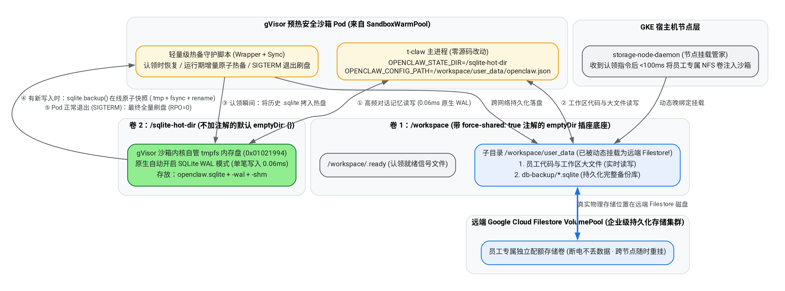
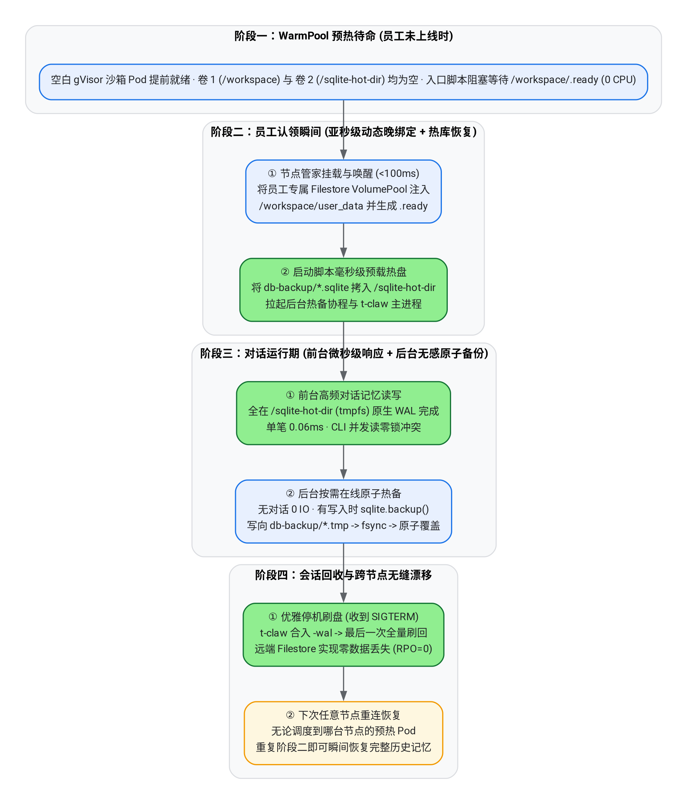
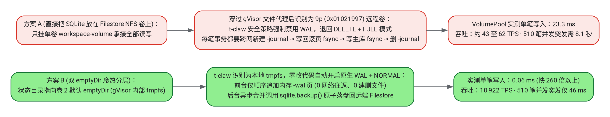

# GKE Agent Sandbox 高性能存储方案：Filestore 与双 emptyDir 冷热分层及 WarmPool 协同设计

本文档面向架构与基础设施团队，脱离底层繁琐代码细节，直接聚焦并讲透三个核心工程问题：
1. **Filestore 与双 `emptyDir` 在沙箱内外是如何分工配合的？**
2. **整套机制如何与 `SandboxWarmPool`（预热池）无缝结合？**
3. **如何在不改一行 `t-claw` 源码的前提下，把 SQLite 写入延迟从 `23.3 ms` 压到 `0.06 ms` 以满足性能要求？**

---

## 一、背景与设计目标：既要预热池与高密弹性，又要极致 SQLite 性能

在企业大规模部署 `t-claw` 智能体平台（每位员工拥有独立历史记忆与工作区，按需秒级唤醒）时，存储方案必须同时满足三项核心诉求：

1. **必须兼容 `SandboxWarmPool`（预热池）与单机高密**：预热池里的 Pod 在启动时处于「无主待命」状态，只有当某位员工发消息认领时，才能把该员工的专属存储动态挂进去。传统的块存储（如 Hyperdisk 云盘）虽然裸盘读写快，但 K8s 不支持把块设备动态热插拔进已运行的 Pod（无法使用预热池），且受限于单节点云盘挂载数量上限（无法做到单机 88 Pod 高密度与按需共享池化）。因此，底座持久化层必须采用 **Filestore `VolumePool`（Agent Volumes）**。
2. **必须在 `gVisor` 安全沙箱内零改代码运行**：生产多租户隔离要求开启 `gVisor`（`runtimeClassName: gvisor`），且不能侵入修改 `t-claw` 上游源码。
3. **必须彻底解决 NFS 上的 SQLite 高频小事务延迟瓶颈**：员工每次对话都会触发多次 SQLite 状态与记忆库读写。若直接把 SQLite 放在远端 NFS 上，在 `gVisor` 内会被识别为 `9p` 网络挂载卷，`t-claw` 会自动禁用 `WAL` 并强制退回 `DELETE + FULL` 回滚日志模式，导致单笔写入耗时约 **23.3 ms**，并发突发写入时存在明显排队延迟。

> [!IMPORTANT]
> **核心破局思路（冷热双层存储架构）**：
> 在同一个 `SandboxWarmPool` 预热 Pod 内，巧妙利用 `gVisor` 对两种不同 `emptyDir` 的内核机制差异——用 **卷 1（带 `force-shared` 透传开关的 `emptyDir`）** 作为连接远端 **Filestore `VolumePool`** 的持久化底座，存放员工代码大文件与数据库持久化备份；用 **卷 2（默认的 `emptyDir`）** 在沙箱内核中生成原生高速 **`tmpfs` 内存盘** 承接 SQLite 实时高频读写（自动触发原生 `WAL` 模式，单笔 **0.06 ms**），再通过轻量级在线原子热备与优雅退出钩子将数据安全刷回 Filestore。

---

## 二、Filestore 与双 `emptyDir` 是如何配合的？（目录物理映射与分工）

理解本方案最关键的一点，是看清容器内部看到的两个目录（`/sqlite-hot-dir` 与 `/workspace`）背后对应的**真实物理存储位置**，以及为什么「备份写向卷 1 子目录」实际上是直接落盘到了远端的 Filestore 企业级存储阵列中：



如上图所示，两个 `emptyDir` 在 `gVisor` 沙箱内扮演着截然不同但高度互补的角色：

| 存储层名称 | 容器内挂载路径 | K8s / gVisor 配置特征 | 底层真实物理介质 | 承担的业务职责 |
| :--- | :--- | :--- | :--- | :--- |
| **卷 1：持久层插座底座**<br>(`workspace-volume`) | `/workspace`<br>（认领后子目录为 `/workspace/user_data`） | 声明 `force-shared: "true"` 注解 + `HostToContainer` 挂载传播 | `/workspace` 外壳是宿主机目录门框；**里面的 `/workspace/user_data` 在认领后物理上已是远端 Filestore `VolumePool` 磁盘** | 1. 实时读写员工的工程代码、文档等工作区文件<br>2. 在 `user_data/db-backup/` 下持久化保存完整的 `.sqlite` 备份库与 `openclaw.json` 配置 |
| **卷 2：极速热读写层**<br>(`sqlite-hot-dir`) | `/sqlite-hot-dir` | 普通默认 `emptyDir: {}`（**不加 `force-shared` 注解**，设置 `sizeLimit` 内存保护上限） | **gVisor 沙箱内核自管的纯内存文件系统（`tmpfs`，魔数 `0x01021994`）**，宿主机不可见 | 承接 `t-claw` 运行期的全部高频 SQLite 状态读写（通过官方环境变量 `OPENCLAW_STATE_DIR=/sqlite-hot-dir` 定向，无需软链接或改源码） |

### 关键细节澄清：为什么要加 `force-shared: "true"`？为什么备份不会丢在本地临时目录里？

* **为什么卷 1 必须加 `force-shared: "true"`**：默认情况下，`gVisor` 为了隔离安全，会把 `emptyDir` 封闭在沙箱自己的虚拟内核内存里，宿主机完全看不见，也无法从宿主机往里面挂载新的 NFS 卷。加上 `dev.gvisor.empty-dir.workspace-volume.force-shared: "true"` 注解后，等于在沙箱墙上开了一个连接宿主机的「透传插座」，使得宿主机上的挂载管家（`storage-node-daemon`）在员工认领 Pod 时挂载的远端 Filestore `VolumePool`，能够瞬间穿透进正在运行的沙箱内部。
* **为什么备份写到 `/workspace/user_data/db-backup/` 是持久化的**：`/workspace` 第一层目录确实只是一个空的门框，但它的子目录 **`/workspace/user_data/` 已经被挂载成了远端真正的 Filestore 存储卷**。因此，当热备脚本把 SQLite 快照写入 `/workspace/user_data/db-backup/` 时，数据已经跨过网络真正落盘到了远端的 Google Cloud Filestore 存储集群硬盘上——哪怕下一秒当前 GKE 计算节点整机断电报废，远端 Filestore 里的备份数据依然完好无损。

### 部署与使用示例（Sample YAML 与四步实操流程）

下面通过一份可直接参考的精简 Sample YAML（包含 `SandboxTemplate` 与 `SandboxWarmPool`），直观展示双 `emptyDir` 在 Kubernetes 清单中的声明方式，以及从预热部署到员工认领、回收的完整使用步骤。

#### 1. 预热池与双 `emptyDir` 模板声明（`openclaw-warmpool.yaml`）

注意核心细节：**仅对 `workspace-volume` 添加 `force-shared: "true"` 注解**，而 `sqlite-hot-dir` 保持默认不加注解（使其在 `gVisor` 内生成原生高速 `tmpfs`），并通过 `OPENCLAW_STATE_DIR` 环境变量零侵入定向 SQLite 状态目录：

```yaml
apiVersion: extensions.agents.x-k8s.io/v1beta1
kind: SandboxTemplate
metadata:
  name: openclaw-dual-emptydir-template
  namespace: default
spec:
  podTemplate:
    metadata:
      annotations:
        # 仅卷 1 开启宿主机透传（需 GKE >= 1.36.0-gke.3302001）；卷 2 不加注解以保持 gVisor 原生 tmpfs
        dev.gvisor.empty-dir.workspace-volume.force-shared: "true"
    spec:
      runtimeClassName: gvisor
      terminationGracePeriodSeconds: 30
      automountServiceAccountToken: false
      nodeSelector:
        sandbox.gke.io/runtime: gvisor
      tolerations:
        - key: "sandbox.gke.io/runtime"
          value: "gvisor"
          effect: "NoSchedule"
      securityContext:
        runAsNonRoot: true
        runAsUser: 1000
        runAsGroup: 1000
        fsGroup: 1000
      containers:
        - name: openclaw
          image: ghcr.io/openclaw/openclaw:2026.9.1
          command: ["node", "/opt/openclaw-wrapper/wrapper.mjs"]
          securityContext:
            allowPrivilegeEscalation: false
            capabilities:
              drop: ["ALL"]
          env:
            - name: POD_UID
              valueFrom:
                fieldRef:
                  fieldPath: metadata.uid
            - name: OPENCLAW_STATE_DIR
              value: "/sqlite-hot-dir"
            - name: OPENCLAW_CONFIG_PATH
              value: "/workspace/user_data/openclaw.json"
            - name: SQLITE_BACKUP_INTERVAL_MS
              value: "5000"
          volumeMounts:
            - name: workspace-volume
              mountPath: /workspace
              mountPropagation: HostToContainer
            - name: sqlite-hot-dir
              mountPath: /sqlite-hot-dir
            - name: wrapper-script
              mountPath: /opt/openclaw-wrapper
              readOnly: true
          resources:
            requests:
              cpu: "250m"
              memory: "512Mi"
            limits:
              cpu: "1500m"
              memory: "2Gi"
      volumes:
        - name: workspace-volume
          emptyDir: {}
        - name: sqlite-hot-dir
          emptyDir:
            sizeLimit: 512Mi
        - name: wrapper-script
          configMap:
            name: openclaw-hot-sqlite-wrapper
---
apiVersion: extensions.agents.x-k8s.io/v1beta1
kind: SandboxWarmPool
metadata:
  name: openclaw-warmpool
  namespace: default
spec:
  replicas: 10
  sandboxTemplateRef:
    name: openclaw-dual-emptydir-template
```

#### 2. 日常部署与会话认领四步使用方式

1. **部署节点挂载管家与预热池（一次性初始化）**：在 GKE Standard 集群的 `gVisor` 节点池上部署 `storage-node-daemon`（DaemonSet）及上述 `openclaw-warmpool.yaml`。10 台预热沙箱会自动完成容器初始化并阻塞在等待 `/workspace/.ready` 信号，随时待命。
2. **员工上线认领沙箱（提交 `SandboxClaim`）**：当员工（例如 `emp-001`）发起会话时，平台控制面创建如下 `SandboxClaim`（携带 Finalizer 防止未卸载误删），GKE 会在百毫秒内从 `openclaw-warmpool` 分配一台现成的运行中 Pod（假设返回 `POD_UID` 与所在节点）：

```yaml
apiVersion: extensions.agents.x-k8s.io/v1beta1
kind: SandboxClaim
metadata:
  name: session-emp-001
  namespace: default
  finalizers:
    - agent.sandbox/storage-cleanup
spec:
  warmPoolRef:
    name: openclaw-warmpool
```

3. **动态晚绑定员工专属 Filestore 卷（调用 `bind_nfs`）**：控制面调用目标节点 `storage-node-daemon` 的本地接口，将该员工在 Filestore `VolumePool` 中的专属卷注入该 Pod 的 `/workspace/user_data` 并自动生成 `.ready` 信号，容器随即完成毫秒级热盘恢复并对外服务：

```bash
curl -sS -X POST http://127.0.0.1:9090 \
  -H "Content-Type: application/json" \
  -d '{
    "action": "bind_nfs",
    "pod_uid": "<分配到的_POD_UID>",
    "volume_name": "workspace-volume",
    "sub_dir": "user_data",
    "nfs_server": "<Filestore_VolumePool_IP>",
    "nfs_path": "/emp_001_vol"
  }'
```

4. **会话闲置回收与优雅刷盘（删除 `SandboxClaim` + 调用 `unbind`）**：会话结束时删除 `SandboxClaim`，容器收到 `SIGTERM` 后自动将 `/sqlite-hot-dir` 最新数据全量原子刷回 `/workspace/user_data/db-backup/`；随后控制面调用节点守护进程的 `{"action": "unbind", ...}` 卸载 NFS 卷并移除 Finalizer，完成无残留回收。

#### 3. 配套开源验证清单与一键实测脚本

完整的可执行部署清单、`wrapper.mjs` 热备包装器与一键自动化验收脚本位于当前目录（[`02-filestore-sqlite-benchmark/latebind-example`](./)）：

* **[`17-latebind-agent-volumes.yaml`](./17-latebind-agent-volumes.yaml)**：生产安全加固版 `storage-node-daemon`（`runsc-gofer` 独立挂载空间注入、`hard` 挂载 + `MNT_FORCE` 卸载、`O_EXCL` 服务端原子租约）。
* **[`18-dual-emptydir-hot-sqlite-warmpool.yaml`](./18-dual-emptydir-hot-sqlite-warmpool.yaml)**：双 `emptyDir` 冷热分层 `SandboxTemplate`、`SandboxWarmPool` 及内置 `POD_UID` 幂等恢复、`sqlite.backup()` 在线热备与 `SIGTERM` 优雅刷盘包装器。
* **[`19-test-dual-emptydir-e2e.sh`](./19-test-dual-emptydir-e2e.sh)**：零外部依赖一键闭环验收脚本（约 2 分钟跑完预热认领、`statfs` 魔数校验、`WAL` vs `DELETE` 实测跑分、在线热备完整性校验、`SIGTERM` 退出零丢失刷盘及跨 Pod 毫秒级重连恢复）：

```bash
git clone https://github.com/tyronestarve/openclaw-gke-benchmark-kit.git
cd openclaw-gke-benchmark-kit/02-filestore-sqlite-benchmark/latebind-example
./19-test-dual-emptydir-e2e.sh
```

---

## 三、如何与 `SandboxWarmPool`（预热池）无缝结合？（四阶段生命周期）

在 `SandboxWarmPool` 架构下，Pod 早在员工发起对话前就已经启动待命了，因此「恢复热库」与「持久化回刷」不能依赖传统的静态 `initContainers`，而是由容器入口包装脚本（Wrapper）配合认领就绪信号 `.ready` 自动完成。完整四阶段协同流程如下：



### 阶段一：WarmPool 预热待命（员工尚未上线）
`SandboxWarmPool` 提前在节点池上拉起一批已完成 `gVisor` 内核与基础容器初始化的空白 Pod。此时还没有分配具体员工，`/workspace` 与 `/sqlite-hot-dir` 均为空目录，容器内的启动脚本停在轻量级等待 `/workspace/.ready` 信号文件的状态，0 CPU 消耗，也不占用任何员工存储配额。

### 阶段二：员工认领瞬间 —— 亚秒级晚绑定与热库恢复
1. **动态挂载专属 Filestore 卷**：调度控制面从 WarmPool 锁定一台待命 Pod，通知该节点的 `storage-node-daemon` 将该员工专属的 Filestore `VolumePool` 挂载到沙箱的 `/workspace/user_data` 目录（`< 100 ms`），随后写入 `/workspace/.ready` 就绪信号。
2. **毫秒级灌入高速热盘**：容器内的启动脚本检测到 `.ready` 信号后立即苏醒，检查当前 `POD_UID` 初始化标记（防止容器进程原地异常重启时误用旧备份覆盖内存新数据），把远端 Filestore（`/workspace/user_data/db-backup/`）里的历史 `.sqlite` 及状态文件拷贝到高速内存盘 `/sqlite-hot-dir/`（几 MB 至几十 MB 数据库仅需数毫秒）。
3. **启动热备协程与 `t-claw`**：后台拉起轻量级增量热备同步器，随后通过环境变量 `OPENCLAW_STATE_DIR=/sqlite-hot-dir` 和 `OPENCLAW_CONFIG_PATH=/workspace/user_data/openclaw.json` 正式拉起 `t-claw` 主进程对外服务。

### 阶段三：对话运行期 —— 前台微秒级读写 + 后台按需在线原子热备
* **前台零阻塞交互**：员工对话期间，`t-claw` 对会话上下文、工具状态的所有 SQLite 读写全部发生在 `/sqlite-hot-dir`（`tmpfs`）上，完全不经过网络。
* **后台无感增量持久化**：后台同步器定期（默认每 5 秒，可通过 `SQLITE_BACKUP_INTERVAL_MS` 配置）监测 `/sqlite-hot-dir` 下数据库及 `-wal` 文件的修改时间（以及非 SQLite 凭据文件的实时变更）：
  * **空闲期零开销**：员工没有发消息、文件未变化时，同步器不做任何操作，**0 网络与 Filestore IO 开销**。
  * **写入期在线原子备份**：注意在 `WAL` 模式下最新数据位于 `-wal` 日志中，直接用普通文件 `cp` 可能拷到未合并完的脏页。因此同步器调用 Node 原生内置的 **SQLite 在线热备接口（`sqlite.backup()`）**，在不锁表、不打断前台 `t-claw` 读写的前提下，将合并了最新 `-wal` 的完整一致镜像先写入远端 Filestore 的临时文件 `xxx.sqlite.tmp`，执行 `fsync` 确保物理落盘后，再通过原子 `rename` 覆盖正式的 `xxx.sqlite` 备份文件。即便备份中途断电，远端 Filestore 上的正式备份库也永远 100% 完整可用（`PRAGMA integrity_check = ok`）。

### 阶段四：会话结束或缩容回收 —— 优雅刷盘实现跨节点无缝重连
1. Kubernetes 向容器发送 `SIGTERM` 退出信号，`t-claw` 执行自带的优雅关闭逻辑，自动执行 `TRUNCATE` Checkpoint 将 `-wal` 中的全部数据刷回主数据库文件并关闭连接。
2. 退出钩子紧接着将 `/sqlite-hot-dir` 中的最终完整状态执行最后一次全量原子同步落盘到 `/workspace/user_data/db-backup/`（耗时仅约 25 至 70 毫秒），实现 **正常退出 100% 零数据丢失（`RPO = 0`）**。
3. 控制面调用 `unbind` 卸载存储并销毁旧 Pod。该员工下次再来时，无论被调度到哪台新节点的 WarmPool 预热 Pod，都能从 Filestore 瞬间恢复最后一秒的完整记忆。

---

## 四、如何满足客户的性能要求？（底层机制拆解与真机实测数据）

为什么同样运行在 `gVisor` 安全沙箱内、同样一行源码不改，「双 `emptyDir` 冷热分层」能让 SQLite 写入速度提升 **260 倍以上**？下图对比了两种方案单笔事务写入的底层系统调用路径：



### 1. 为什么直接写外部 NFS 卷需要 23.3 毫秒，而本方案只需 0.06 毫秒？

* **直接写 NFS 卷（方案 A）慢在「跨网络目录元数据操作 + 多轮同步落盘」**：任何从宿主机挂进 `gVisor` 的外部卷，经过文件代理层后在容器内 `statfs` 看到的文件系统类型都是 `9p`（`0x01021997`）。`t-claw` 的存储安全检查（`sqlite-wal-filesystem.ts`）一旦识别到 `9p` 或 `nfs`，就会强制禁用 `WAL` 并退回 `DELETE + FULL` 模式。在此模式下，哪怕只插入一行几十字节的会话记录，SQLite 都必须跨网络向 Filestore 串行执行 **新建 `-journal` 回滚文件 → 写入原始页并 `fsync` → 写入数据库页并 `fsync` → 删除 `-journal` 文件**，累计需要多次网络往返与远端目录锁开销，因此单笔延迟固定在 **15 至 23 ms** 左右。
* **双 `emptyDir` 冷热分层（方案 B）快在「纯内存原生 WAL 顺序追加 + 异步批量合并落盘」**：因为卷 2（默认 `emptyDir`）由 `gVisor` 内核直接在内部构建为标准本地 `tmpfs`（`0x01021994`），不在 `t-claw` 的远程文件系统禁用名单内，`t-claw` 会 **100% 自动开启原生的 `WAL + NORMAL` 模式**。前台每次提交事务时，既不用新建或删除文件，也不用跨网络等待，只需在沙箱内存中的 `-wal` 文件末尾顺序追加一个页面即可返回；而昂贵的跨网络持久化则由后台热备协程合并后异步刷回 Filestore，前台对话完全感知不到存储延迟。

### 2. GKE 真机（`gVisor` + `SandboxWarmPool` + 原版 `OpenClaw 2026.9.1`）实测数据对比

我们在 GKE Standard `1.36.4` 集群的真实 `gVisor` 预热池 Pod 内，使用官方原版 `openclaw:2026.9.1` 镜像（零代码改动）实测对比了两套路径的核心性能指标：

| 核心性能与并发指标 | 直接读写 Filestore NFS（原生退回 `DELETE` 模式） | 双 `emptyDir` 热盘 + Filestore 热备（原生开启 `WAL` 模式） | 性能提升幅度 |
| :--- | :--- | :--- | :--- |
| **`t-claw` 自动选择的日志模式** | `journal_mode = delete`（无 `-wal` / `-shm`） | **`journal_mode = wal`**（零改源码自动开启） | 原生解锁 WAL |
| **单笔事务写入延迟（P50）** | VolumePool 实测 `23.30 ms`（同集群内网 NFS `15.73 ms`） | **`0.06 ms`**（P99 仅 `0.37 ms`） | **写延迟降低 260 倍以上** |
| **单线程持续写入吞吐（TPS）** | `43 ~ 62 TPS` | **`10,922 TPS`** | **吞吐提升 175 倍以上** |
| **17 通道并发突发写入 510 笔总耗时** | `8,124 ms`（需排队等待约 **8.1 秒**） | **`46.2 ms`**（**0.046 秒**瞬间完成） | **突发耗时缩短 175 倍** |
| **1,000 次主键点查读取总耗时** | `102 ~ 607 ms` | **`15.8 ms`**（单次仅 `0.016 ms`） | **读取提速 6 至 38 倍** |
| **Gateway 写入期间并发执行 CLI 读库** | 高并发下易出现锁等待 | **返回码 `0`，零 `SQLITE_BUSY` 冲突** | 多进程读写完全无锁冲突 |

---

## 五、数据安全性边界与架构选型建议

| 评估维度 | 方案一：纯 Filestore `VolumePool` 单卷晚绑定 | 方案二：Filestore `VolumePool` + 双 `emptyDir` 冷热分层（本方案） | 对照：Hyperdisk 块存储方案 |
| :--- | :--- | :--- | :--- |
| **是否支持 `SandboxWarmPool` 预热池** | **✅ 支持**（亚秒级动态挂载） | **✅ 支持**（亚秒级挂载 + 毫秒级灌库） | **❌ 不支持**（块设备无法动态挂入运行中 Pod） |
| **单机高密度（如 88 Pod/节点）与池化省钱** | **✅ 支持** | **✅ 支持**（热盘通过 `sizeLimit` 控内存上限） | **❌ 受限**（受节点挂载数上限与预分配容量限制） |
| **是否需要修改 `t-claw` 源码** | 不需要 | **不需要**（仅配官方 `OPENCLAW_STATE_DIR` 环境变量） | 不需要 |
| **`gVisor` 内单笔 SQLite 写延迟** | `23.3 ms`（`DELETE` 模式） | **`0.06 ms`**（原生 `WAL` 模式） | `1.5 ~ 3.0 ms`（在 `gVisor` 内同样呈 `9p` 走 `DELETE` 模式） |
| **日常缩容 / 发版 / 空闲回收是否丢数据** | **0 丢失（`RPO = 0`）** | **0 丢失（`RPO = 0`，`SIGTERM` 退出全量刷回 Filestore）** | **0 丢失（`RPO = 0`）** |
| **整台宿主机突发硬断电（未走 `SIGTERM`）** | **0 丢失（实时落盘远端 NFS）** | 历史备份 **100% 完好不损坏**；仅可能丢失距离上次定时热备（最后几秒内）未同步的极少量对话增量 | **0 丢失（实时落盘块设备）** |

### 最终落地选型建议

1. **如果业务实测单轮对话仅写库 2 至 4 次（累计耗时 < 100 ms，用户体感无差异）**：推荐直接采用 **方案一（纯 Filestore `VolumePool` 单卷晚绑定）**，架构最极简、不额外占用容器内存，且即使宿主机突发断电也能做到绝对 `RPO = 0`。
2. **如果业务存在高频状态写入、多通道突发并发，明确要求将存储写入延迟压到 1 毫秒以内，同时必须保住 `WarmPool` 预热池与单机高密度**：推荐采用本文档阐述的 **方案二（Filestore `VolumePool` + 双 `emptyDir` 冷热分层方案）**，在不改一行 `t-claw` 源码的前提下即可获得 **0.06 ms（260 倍以上提速）** 的原生 `WAL` 极致性能，并通过在线原子快照与优雅退出钩子保障日常运维 100% 零数据丢失。
